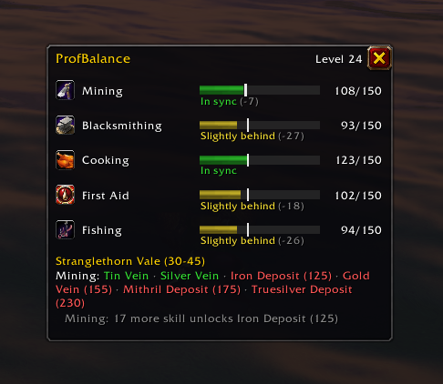

# ProfBalance – keep your professions in step with your level (WoW: Forever)

A small addon for World of Warcraft: Forever that answers two questions while you level:
*are my professions keeping pace with my character?* and *can I gather or skill up where I am right now?*

Download: [CurseForge](https://www.curseforge.com/wow/addons/profbalance) · [GitHub releases](https://github.com/oncolour/ProfBalance/releases)



## What it shows

A small movable window with:

- **One row per profession**: icon, skill/cap, a 0–300 bar with a white marker for where your
  level expects you to be, and a verdict: *In sync*, *Slightly behind*, *Behind*, *Far behind*
  or *Ahead*. When you can train the next rank (Journeyman / Expert / Artisan) the verdict is
  replaced by a yellow reminder.
- **Zone panel**: for Mining and Herbalism the nodes of your current zone are listed in colour:
  green gives skill-ups, gray is too easy, red is locked with the requirement in brackets.
  Skinning is judged against the zone's level range. A one-line tip follows, such as
  "5 more skill unlocks Silver Vein (75)" or "everything here is gray – move on".
- **Zone suggestions**: when the current zone has nothing left to give, the two best zones near
  your level where nodes still give skill-ups are suggested. The row tooltip lists the top three.
- **Level-up summary in chat** for professions that lag behind (can be turned off).
- **Minimap button**: left-click toggles the window, right-click prints the summary, drag to move
  it around the minimap. Hide it with `/profbalance minimap`.

### The model

**Mining and Herbalism** use a data-driven target: the skill needed to gather about 80% of the
node spawns in zones whose level range contains your level. Zones close to your level weigh
more, and the value is smoothed over ±2 levels. The curve is roughly 40 at level 10, 75 at 20,
125 at 25, 145 at 30, 230 at 45 and 275 at 60 for Mining; Herbalism runs slightly higher
(about 107 at 20, 148 at 30, 290 at 60).

**All other professions** use the classic rule of thumb **skill ≈ 5 × level** (max 300, nothing
expected before level 5). It matches the game's own formulas (weapon skill and skinning
requirements are 5 × level) and the fact that crafted gear roughly requires level ≈ skill / 5.

The difference from the target gives the verdict: ≥ −10 in sync, −11…−40 slightly behind,
−41…−90 behind, below that far behind, above +25 ahead. The row tooltip says which target is used.

Node counts per zone come from GatherMate2's Forever export from Wowhead (v2026-10-17),
aggregated into spawns per node type and zone (`ZoneNodes.lua`). Zone names are
resolved live via `C_Map`. Two new Forever zones (uiMapID 2521/2548) are identified as Zephras
Isle and Riverglades from their node content; please report mismatches.

## Commands

```
/profbalance            toggle the window (also /pbal)
/profbalance lock|unlock
/profbalance reset      reset position and scale
/profbalance scale 1.2
/profbalance minimap    show/hide the minimap button
/profbalance secondary  show/hide Cooking, First Aid, Fishing
/profbalance rare       also list rare nodes (Black Lotus etc.)
/profbalance announce   level-up summary on/off
/profbalance summary    print the current state to chat
/profbalance debug      client version, zone id, raw profession values
```

The addon also appears in the addon compartment menu next to the minimap.

## Installation

**Players:** install from [CurseForge](https://www.curseforge.com/wow/addons/profbalance) (works with the
CurseForge app), or download the zip from the [latest release](https://github.com/oncolour/ProfBalance/releases)
and unpack it so that you get `World of Warcraft\_forever_\Interface\AddOns\ProfBalance\ProfBalance.toc`.

**Developers:**

```
npm install                       # once; fetches fengari for the headless tests
npm test                          # run the test suite (no WoW client needed)
node tools/install.js             # junction into _forever_/Interface/AddOns/ProfBalance
node tools/install.js --copy      # copy instead of linking
node tools/install.js --remove    # uninstall
npm run build:zones               # rebuild ZoneNodes.lua from GatherMate2_Data after it updates
```

After installing, `/reload` in game, or restart the client if the addon is new.

## Verified in game

- Forever 1.60.1 build 70862, Interface 16001: loads, reads all professions with correct skill
  lines, resolves the zone and its node data, minimap button sits on the rim.

Still to confirm by players at other levels: the rank reminders at skill 125/200, the inferred
level ranges of Zephras Isle and Riverglades, and the rank thresholds of Cooking / First Aid /
Fishing (book/quest based on Forever).

## Release

```
node tools/package.js               # builds dist/ProfBalance-<version>.zip for manual upload
git tag v0.1.0 && git push --tags   # GitHub Actions builds the same zip and creates a release
```

CurseForge packages the repository automatically from the GitHub webhook when a tag is pushed (see `.pkgmeta`).

## License and sources

ProfBalance is free software under the **GNU GPL v2 or later** (see `LICENSE`).
The zone table `ZoneNodes.lua` is an aggregate (spawns per node type and zone)
derived from **GatherMate2_Data** by kagaro, Xinhuan, Spinx and Marrtin (GPL v2+), which in
turn is built from **Wowhead** data. The script that does the derivation lives in `tools/`.
Node and rank skill requirements are the game's own values, checked against community guides.

## Layout

```
ProfBalance.toc    Interface 16001 (addon files live in the repo root so CurseForge can package it)
Data.lua           skill lines, ranks, node requirements, zone level ranges
ZoneNodes.lua      generated: node counts per zone
Core.lua           pure logic (testable without WoW)
API.lua            pcall-guarded WoW API wrapper, treats secret values as missing
UI.lua             the window and tooltips
MinimapButton.lua  minimap button without libraries
ProfBalance.lua    events, SavedVariables, slash commands
Media/             icons
tests/               fengari-based test suite with a WoW mock
tools/               install.js, package.js, build_zone_nodes.js
docs/                design notes, CurseForge text, screenshots
```
